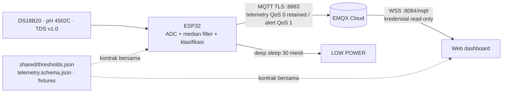

# Water Quality Monitoring System

> Monitoring kualitas air real-time berbasis ESP32, MQTT over TLS, dan dashboard React.

Sistem ini mengukur **suhu, pH, dan TDS**, mengirim telemetry ke broker EMQX Cloud, lalu menampilkannya di dashboard web. Klasifikasi mengikuti **Permenkes No. 2 Tahun 2023** dan dibatasi pada **kelayakan fisik-kimia** (parameter mikrobiologi tidak diukur sensor).

| | |
|---|---|
| **Perangkat** | ESP32 DevKit V1 + DS18B20 + pH 4502C + TDS Meter v1.0 |
| **Siklus** | Active window ± 10–17 s, deep sleep 30 menit (48 siklus/hari) |
| **Telemetry** | QoS 0, retained — langsung tampil saat dashboard dibuka |
| **Alert** | QoS 1, menunggu PUBACK sebelum perangkat tidur |
| **Klasifikasi** | LAYAK / TIDAK LAYAK (fisik-kimia), label guna: konsumsi · mandi · cuci baju |
| **Status build** | Firmware 25/25 test · Web 97/97 test · `tsc`, `lint`, `build` hijau |

## Daftar isi

- [Arsitektur](#arsitektur)
- [Fungsionalitas](#fungsionalitas)
- [Tech stack](#tech-stack)
- [Struktur projek](#struktur-projek)
- [Kontrak data](#kontrak-data)
- [Klasifikasi & Permenkes 2/2023](#klasifikasi--permenkes-22023)
- [Wiring](#wiring)
- [Menjalankan proyek](#menjalankan-proyek)
- [Konfigurasi & keamanan](#konfigurasi--keamanan)
- [Anggaran waktu & energi](#anggaran-waktu--energi)
- [Status saat ini](#status-saat-ini)
- [Yang masih perlu dilakukan](#yang-masih-perlu-dilakukan)

---

## Arsitektur



Alur satu siklus: **bangun → nyalakan sensor (gate GPIO26) → sampling → konversi & klasifikasi → WiFi/NTP/TLS/MQTT → publish → PUBACK → matikan sensor → deep sleep**. Watchdog memotong siklus bila active window melewati 30 s.

---

## Fungsionalitas

### Firmware
- ADC 11 dB via `analogReadMilliVolts()`, median 30 sampel per sensor, pembagi `DIV_PH = 1,5` diterapkan di kode.
- Konversi tegangan ke pH (kalibrasi 2 titik) dan TDS (kompensasi suhu + baseline `V_TDS0` + gain `TDS_K`).
- Klasifikasi status dan alert rule dibaca dari `shared/thresholds.json` — satu sumber kebenaran untuk firmware dan web.
- Captive portal WiFi: jika belum ada kredensial, ESP32 membuka hotspot untuk memilih SSID/password dari HP; kredensial disimpan di NVS.
- MQTT over TLS dengan CA certificate pinning (`setInsecure()` **dilarang**).
- Sensor dipadamkan via **MOSFET gate GPIO26** sebelum `esp_deep_sleep_start()`.
- `seq`, cache WiFi channel/BSSID, dan waktu NTP sync disimpan di `RTC_DATA_ATTR`.
- Env `calibration` mencetak tegangan ADC tiap 1 detik tanpa WiFi/sleep untuk keperluan kalibrasi.

### Web dashboard
- Subscribe topik **exact** telemetry + `water_quality/+/alert` (wildcard `#` tidak dipakai karena tidak di-route broker ini).
- Setiap payload divalidasi `zod`; pesan invalid dibuang dan dihitung.
- State perangkat `online` / `stale` / `offline` dari usia `ts`, bukan dari koneksi MQTT.
- Kartu sensor dengan **status per parameter** (bukan status global), badge status, banner alert QoS 1, dan panel kelayakan tiga guna.
- Riwayat 48 poin di `localStorage` (ring buffer + dedup by `ts` + re-validasi saat hydrate).
- Grafik terpisah per sensor dengan sumbu dan garis ambang sendiri, garis `linear`, label sumbu, tooltip satu nilai, rentang 1/6/12/24 jam.
- Panel keberlanjutan: active window, duty cycle, estimasi energi, estimasi umur baterai.
- Dark mode toggle (tersimpan di localStorage, awalnya mengikuti sistem), layout mobile-first.

### Simulator
`node tools/simulate_device.mjs <scenario>` — skenario `normal`, `high-tds`, `bad-ph`, `missed-cycle`, `malformed`.

---

## Tech stack

| Layer | Pilihan | Catatan |
|-------|---------|---------|
| Firmware build | PlatformIO, `espressif32`, Arduino framework | `default_envs = esp32dev` |
| MQTT ESP32 | `256dpi/MQTT` + `WiFiClientSecure` | Mendukung QoS 1 & retain; **bukan** PubSubClient |
| JSON firmware | `bblanchon/ArduinoJson @ ^7` | Juga dipakai test native |
| Sensor | `OneWire` + `DallasTemperature` | DS18B20 12-bit |
| Logika firmware | C++17 murni di `lib/water_logic` | Tanpa header Arduino, testable di host |
| Test firmware | Unity (`pio test -e native`) | Butuh compiler C++ host (`g++`) |
| Frontend | Vite + React + TypeScript (`strict`) | — |
| Styling | Tailwind CSS v4 via `@tailwindcss/vite` | Tanpa `tailwind.config.js` |
| Chart | Recharts | 3 grafik mandiri |
| MQTT web | `mqtt` (mqtt.js) over WSS | Kredensial read-only |
| Validasi | `zod` | Telemetry & alert |
| Test web | Vitest + React Testing Library + jsdom | `mqtt` di-`vi.mock`, tanpa network |
| Broker | EMQX Cloud Serverless (Asia Tenggara) | TLS 8883 / WSS 8084 |
| Deploy | Netlify | Static build dari `web-dashboard/` |

---

## Struktur projek

```
.
├── AGENTS.md                    # aturan kerja agen
├── README.md                    # dokumentasi ini (source of truth)
├── shared/                      # kontrak firmware ↔ web
│   ├── thresholds.json          # ambang klasifikasi (sumber kebenaran tunggal)
│   ├── telemetry.schema.json    # JSON Schema payload
│   └── fixtures/                # contoh payload untuk kedua test suite
├── firmware/
│   ├── platformio.ini           # env: esp32dev, native, calibration
│   ├── include/
│   │   ├── secrets.example.h    # template (gitignored: secrets.h)
│   │   └── secrets.h            # kredensial perangkat (gitignored)
│   ├── lib/water_logic/         # PURE C++: median_filter, sensor_math, classifier, payload
│   ├── src/                     # hardware layer: main, hal_sensors, net, wifi_manager
│   └── test/test_native/        # Unity test, dijalankan di PC
├── web-dashboard/
│   ├── .env.example             # template env (gitignored: .env)
│   ├── vite.config.ts           # konfigurasi Vite + Vitest
│   ├── public/favicon.svg
│   └── src/
│       ├── App.tsx
│       ├── components/          # SensorCard, QualityStatusBadge, HistoricalChart,
│       │                        # DeviceStatus, SustainabilityPanel, UsageSuitability,
│       │                        # ThemeToggle
│       ├── hooks/               # useTelemetry, useTheme
│       ├── services/mqttClient.ts
│       ├── lib/                 # parseTelemetry, parseAlert, classify, history,
│       │                        # staleness, theme, chartDomain, chartConfig
│       └── __tests__/           # Vitest + React Testing Library
├── tools/
│   ├── .env.example
│   └── simulate_device.mjs      # simulator telemetry
├── AturanPermenkesKlasifikasiAir.md       # referensi regulasi (belum di-track)
└── kalibrasi_sensor_air_esp32/            # sketch kalibrasi (belum di-track)
```

---

## Kontrak data

### Telemetry — `water_quality/<device_id>/telemetry` (QoS 0, `retain=true`)

```json
{
  "device_id": "esp32_water_01",
  "ts": 1767225600,
  "seq": 128,
  "temperature": 27.5,
  "ph": 7.2,
  "tds_ppm": 145.0,
  "status": "DRINKABLE",
  "active_time_ms": 18400,
  "rssi": -61,
  "fw": "0.2.0"
}
```

`ts` adalah epoch detik dari NTP; `seq` adalah boot counter di RTC memory untuk mendeteksi siklus terlewat. Field opsional: `battery_mv`.

### Alert — `water_quality/<device_id>/alert` (QoS 1, `retain=false`)

```json
{
  "device_id": "esp32_water_01",
  "ts": 1767225600,
  "reasons": ["PH_OUT_OF_RANGE"],
  "values": { "ph": 9.1 }
}
```

Reason yang dikenal: `PH_OUT_OF_RANGE`, `TDS_GT_MAX`, `UNFIT` (legacy). Payload alert divalidasi zod dan difilter per `deviceId`.

---

## Klasifikasi & Permenkes 2/2023

Berdasarkan **Permenkes No. 2 Tahun 2023**, Tabel 1 (Air Minum) dan Tabel 3 (Air Higiene & Sanitasi):

| Parameter | LAYAK | TIDAK LAYAK |
|-----------|-------|-------------|
| pH | `6,5 ≤ pH ≤ 8,5` | di luar rentang |
| TDS | `< 300 ppm` | `≥ 300 ppm` |
| Suhu | udara ± 3 °C | tidak dipakai untuk status (lihat catatan) |

Batas bawah inklusif, batas atas eksklusif, kecuali pH yang **kedua batasnya inklusif**. Alert dipicu pada pH di luar `[6,5, 8,5]` atau **TDS ≥ 300 ppm**. Aturan *worst-parameter-wins*: satu parameter yang melanggar membuat status menjadi `TIDAK LAYAK`.

**Label guna di UI:** `konsumsi`, `mandi`, `cuci baju`. Ketiganya memakai **ambang yang sama**, karena Permenkes 2/2023 tidak membedakan batas fisik-kimia antar guna — kategori Air Minum bahkan sudah mencakup mandi dan mencuci bahan pangan. Angka `TDS < 1000` yang lama berasal dari Permenkes 32/2017 yang **dicabut Pasal 51** peraturan ini, sehingga tidak dipakai lagi.

**Status enum:** `DRINKABLE`, `HYGIENE_OK`, `UNFIT`. Firmware hanya menghasilkan `DRINKABLE` / `UNFIT`; `HYGIENE_OK` tetap diterima untuk kompatibilitas payload lama.

> **Batasan penting:** sensor hanya mengukur pH, TDS, dan suhu. Regulasi juga mensyaratkan kekeruhan < 3 NTU, warna 10 TCU, tidak berbau, serta E. coli/Coliform = 0 CFU/100 mL — semuanya **tidak terukur**. Jadi `LAYAK` berarti **layak secara fisik-kimia**, bukan jaminan aman diminum secara mikrobiologis.

---

## Wiring

| Fungsi | GPIO | Komponen | Catatan |
|--------|------|----------|---------|
| OneWire Data | GPIO4 | DS18B20 DATA | Pull-up 4,7 kΩ ke 3V3 |
| pH Signal | GPIO35 | pH 4502C Po | Pembagi 10k/20k; `DIV_PH = 1,5` di kode |
| TDS Signal | GPIO32 | TDS v1.0 Analog Out | Tanpa pembagi |
| Baterai (opsional) | GPIO33 | Pembagi baterai | — |
| Sensor gate | GPIO26 | MOSFET / load switch | Digital output |

- **ADC1 only** (GPIO32/33/35) untuk analog; jangan pakai ADC2 saat WiFi aktif.
- pH 4502C membutuhkan **5 V**; TDS v1.0 dan DS18B20 memakai **3,3 V**. Ground harus bersama.
- Gate GPIO26: HIGH → sensor menyala (warm-up ≈ 2 s), LOW → mati sebelum deep sleep. Gunakan MOSFET logic-level (mis. IRLZ44N) dengan pull-down 10 kΩ.
- Rentang linier ADC ESP32 pada 11 dB ≈ 150–2450 mV; pembacaan di atas itu tidak andal.

---

## Menjalankan proyek

Jalankan dari direktori yang tertera.

| Task | Direktori | Perintah |
|------|-----------|----------|
| Test firmware (host) | `firmware/` | `pio test -e native` |
| Build firmware | `firmware/` | `pio run -e esp32dev` |
| Build mode kalibrasi | `firmware/` | `pio run -e calibration` |
| Flash & monitor (**user only**) | `firmware/` | `pio run -t upload` / `pio device monitor` |
| Install dependency web | `web-dashboard/` | `npm install` |
| Dev server | `web-dashboard/` | `npm run dev` |
| Test web | `web-dashboard/` | `npx vitest run` |
| Coverage | `web-dashboard/` | `npx vitest run --coverage` |
| Typecheck / lint / build | `web-dashboard/` | `npx tsc --noEmit` / `npm run lint` / `npm run build` |
| Simulator | repo root | `node tools/simulate_device.mjs <scenario>` |

Jika `pio test -e native` gagal karena tidak ada `g++`, pasang compiler host C++ terlebih dahulu — jangan melewati test.

---

## Konfigurasi & keamanan

Salin template lalu isi nilai asli. File aslinya gitignored dan **tidak boleh di-commit**.

| File template | Tujuan |
|---------------|--------|
| `firmware/include/secrets.example.h` → `secrets.h` | WiFi & kredensial device MQTT |
| `web-dashboard/.env.example` → `.env` | `VITE_MQTT_BROKER_URL`, `VITE_DEVICE_ID`, `VITE_MQTT_USER`, `VITE_MQTT_PASS` |
| `tools/.env.example` → `.env` | Kredensial simulator |

- ACL broker: device hanya boleh **publish** di topik perangkatnya; dashboard hanya boleh **subscribe**.
- Karena variabel `VITE_*` ikut ter-bundle, kredensial web **wajib read-only** (`dashboard_ro`).
- Untuk Netlify, set kelima environment variable di panel site, lalu deploy dari `web-dashboard/`.

---

## Anggaran waktu & energi

| Tahap | Estimasi |
|-------|----------|
| Boot + init | 0,3 s |
| Warm-up + sampling (30 sampel/sensor) | 3–5 s |
| WiFi connect (cache channel/BSSID) | 2–5 s |
| NTP + TLS + MQTT connect | 3–5 s |
| Publish + flush / PUBACK | 0,5–1 s |
| **Total** | **≈ 10–17 s** |

Target active window ≤ 20 s; hasil ukur 50 siklus: mean **10,94 s**, p50 10,70 s, p95 **13,68 s**, max 14,20 s. Watchdog memotong siklus di atas 30 s.

Rumus: `E_day = 48 × (P_active × t_active) + P_sleep × (24 jam − 48 × t_active)`.

Konstanta `SustainabilityPanel.tsx` (2026-11-23): `VOLTAGE_V=3,7`, `ACTIVE_MA=214` (hasil ukur, fluktuatif), `SLEEP_MA=13,5` (hasil ukur stabil 13–14 mA), `CAPACITY_MAH=3000` (nilai nominal 18650), `CYCLE_S=1800`.

Dengan active window rata-rata 10,94 s, estimasi kebutuhan energi ≈ **1.308 mWh/hari** dan umur baterai ≈ **8,5 hari**. Angka tetap **perkiraan** karena arus aktif berfluktuasi dan kapasitas baterai belum diverifikasi dengan uji discharge. Dominan pemakaian energi berasal dari arus sleep (13,5 mA × ~29,8 menit/siklus), bukan active window — penurunan arus sleep adalah cara paling efektif memperpanjang umur baterai.

---

## Status saat ini

| Area | Status | Catatan |
|------|--------|---------|
| Firmware | ✅ Stabil | Build `esp32dev` & `calibration` SUCCESS, Unity **25/25 PASSED** |
| Web | ✅ Stabil | Vitest **97/97 PASSED**, `tsc`/`lint`/`build` hijau |
| Kalibrasi pH/TDS | ✅ Terpasang | `V_PH7=2,852 V`, `V_PH4=3,030 V` (slope 59,3 mV/pH), `V_TDS0=0,2531 V` |
| Klasifikasi | ✅ Sesuai regulasi | Permenkes 2/2023, satu ambang fisik-kimia untuk tiga guna |
| UI/UX | ✅ Lengkap | Grafik per sensor, dark mode, panel kelayakan guna |
| Energi | ⚠️ Estimasi | Arus aktif/sleep sudah diukur; kapasitas 3000 mAh masih nominal |
| Deploy | ✅ Ter-push | `origin/main` sejajar dengan commit terbaru; Netlify auto-deploy |

Catatan teknis:
- Urutan argumen `publish()` 256dpi/MQTT sudah diperbaiki menjadi `(topic, payload, retained, qos)` — sebelumnya payload terkirim kosong.
- Broker EMQX yang dipakai tidak me-route wildcard `#`; `+` dan topik exact normal. Dashboard memakai topik exact + `water_quality/+/alert`.
- Sensor kekeruhan (SEN0189/NTU) sudah dihapus dari seluruh stack.
- Suhu sengaja tidak dijadikan penentu status; hanya dipakai untuk kompensasi TDS.

---

## Yang masih perlu dilakukan

| Prioritas | Item | Penanggung |
|-----------|------|------------|
| 1 | Field test 24–48 jam: retained telemetry, alert QoS 1, transisi `online → stale → offline`, isi grafik | User |
| 2 | Verifikasi kapasitas nyata baterai 18650 (uji discharge) untuk mengganti nilai nominal 3000 mAh | User |
| 3 | Kalibrasi span TDS dengan larutan 342 ppm (`t 342`), kirim `TDS_K` baru bila ingin akurasi lebih tinggi | User |
| 4 | Validasi titik pH 7 pasca-flash (baru tervalidasi di buffer 4,01) | User |
| 5 | Putuskan nasib 2 file referensi yang belum di-track: `AturanPermenkesKlasifikasiAir.md` dan `kalibrasi_sensor_air_esp32/` | User |
| Opsional | Tambah `.github/workflows/ci.yml`, ukur coverage ≥ 80%, E2E Playwright | Agen |
